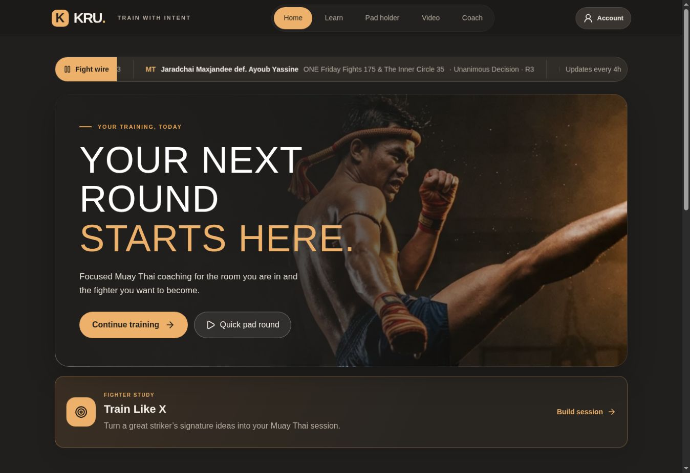
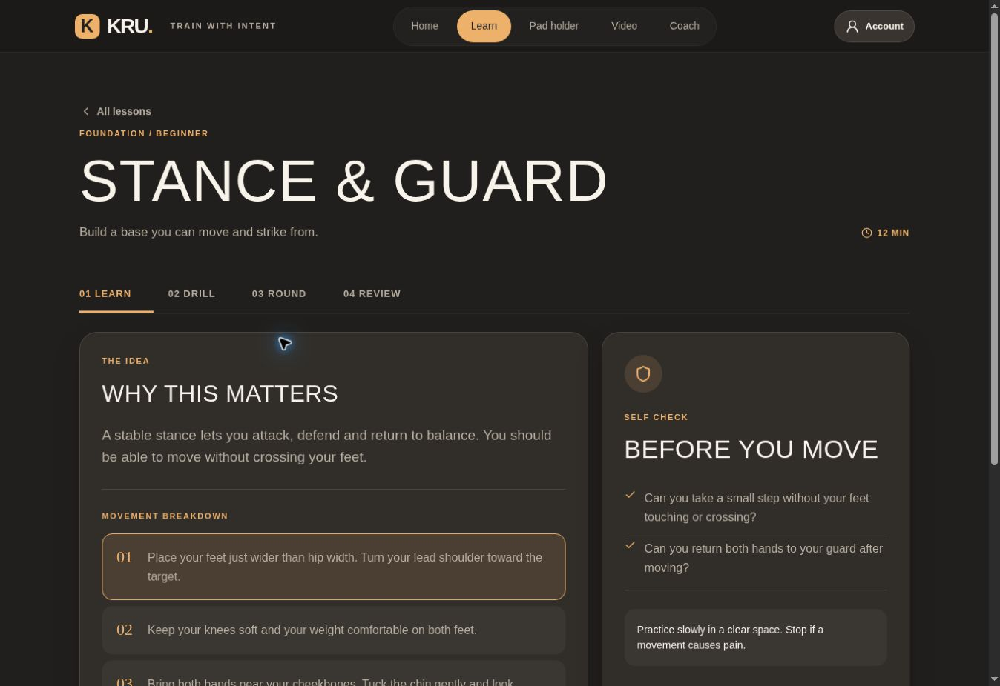
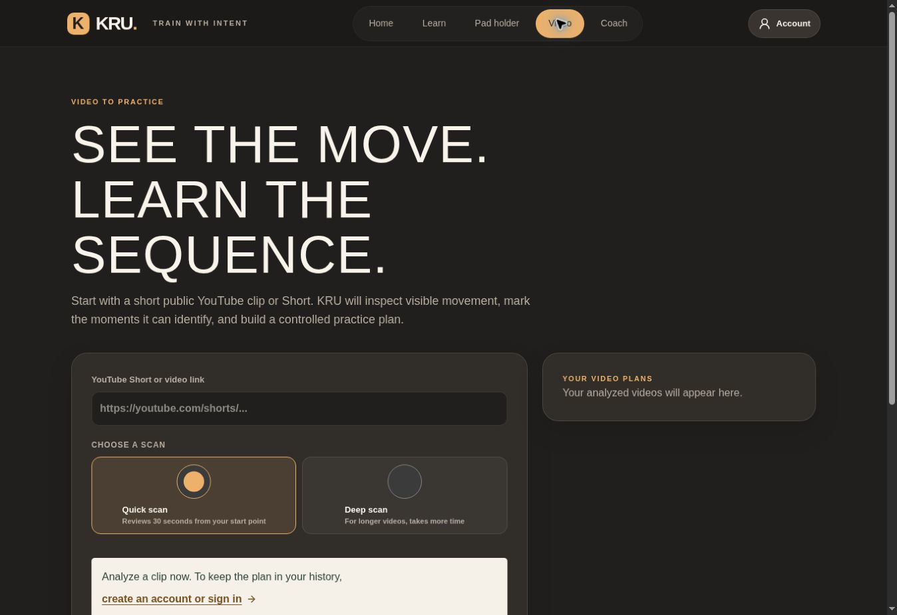

# KRU
### AI Muay Thai Coaching Application

**Making solo practice easier to start, follow, and improve.**

| Role | Product | Status |
| :--- | :--- | :--- |
| Independent product owner and AI assisted development lead | Consumer learning and sports technology | **In development** |

## Product vision

A solo practitioner may know a technique but still struggle to choose a session, turn instructional video into drills, or decide what to practice next. KRU connects learning, guided rounds, and contextual coaching in one training experience.

**Primary users:** Beginners building fundamentals and intermediate practitioners seeking structured solo sessions.

**Core job:** “Help me know what to practice, how to practice it, and what to work on next.”

## My contribution

I defined the product vision and feature priorities, shaped learner journeys and requirements, and directed development iterations with Codex. I reviewed Groq, Gemini, and YouTube integrations, defined test scenarios, and balanced usability, provider limits, operating cost, and release readiness.

## The experience

| Journey | Implemented experience | Product decision |
| :--- | :--- | :--- |
| Learn a fundamental | Six lessons covering stance, jab, cross, footwork, and lead and rear teeps | Teach the idea before asking the learner to perform a round. |
| Practice a round | Learn, drill, round, and review stages; pad session controls and voice cues | Keep a useful training loop available independently of an AI response. |
| Turn video into practice | Public YouTube video and Shorts input, Quick and Deep scan choices, structured practice output | Give users a choice between a focused scan and a longer analysis. |
| Ask the coach | Training questions and combination suggestions with conversational context | Keep text coaching distinct from claims about observed movement. |
| Explore a fighter’s style | Fighter discovery, evidence checks, assessment inputs, and playable training plans | Separate verified fighter facts from generated training suggestions. |
| Practice with a camera | Browser based pose tracking and limited fundamentals feedback | Process live pose tracking on the device; describe its limits clearly. |

Source implementation and hosted interface were reviewed on October 18, 2026. Integration availability and the hosted build can differ from the latest source.

## AI product judgment

KRU uses **Groq for conversational coaching**, **Gemini for multimodal video and structured training tasks**, and **YouTube APIs for discovery and video metadata**. These services solve different parts of the journey.

The implementation addresses timeouts, unavailable services, quota errors, repeat requests, and malformed responses. Reusable results are cached, output size is bounded, and Quick scan limits the initial scope of video work. No comparative latency benchmark or measured cost advantage is claimed.

[Explore the provider decisions and tradeoffs →](docs/DECISION_LOG.md)

## Delivery and quality

The documented **107-test release candidate** is a historical milestone recorded in my October 12, 2026 AI Product Manager resume. It is not the current suite count or evidence of a completed production release.

The private repository contains tests for fighter verification and fallback behavior, structured video responses, motion logic, session timing, voice policy, and account related flows. Current release work includes provider validation and real device camera and audio checks.

[Read the QA and release evidence →](docs/EVALUATION_AND_RELEASE.md)

## Product evidence

| Document | What it demonstrates |
| :--- | :--- |
| [Product brief, user journeys, and acceptance criteria](docs/PRODUCT_BRIEF.md) | Translating the application into scoped, testable requirements |
| [AI and architectural decision record](docs/DECISION_LOG.md) | Model and API fit, cost controls, reliability, and trust tradeoffs |
| [QA, prioritization, and development roadmap](docs/EVALUATION_AND_RELEASE.md) | Separating implemented work, release gates, and future scope |

## Real application screens

### Guided fundamentals

### Video analysis entry

Screenshots were captured from the hosted application on October 18, 2026. They show the actual interface with no personal account data; the video screen shows the entry flow, not a completed analysis.

Documentation and reviewed screenshots only. Application source and private product data are not included.
